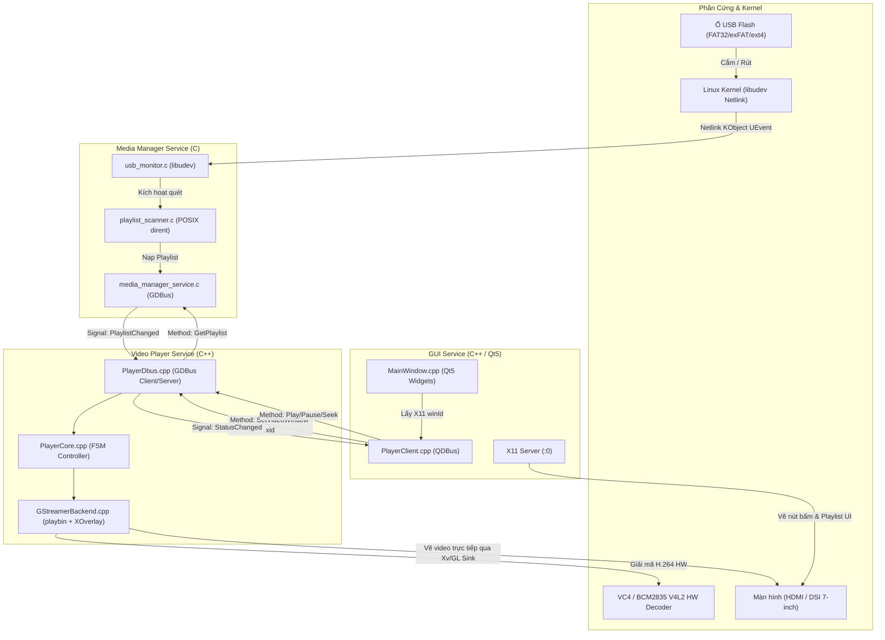
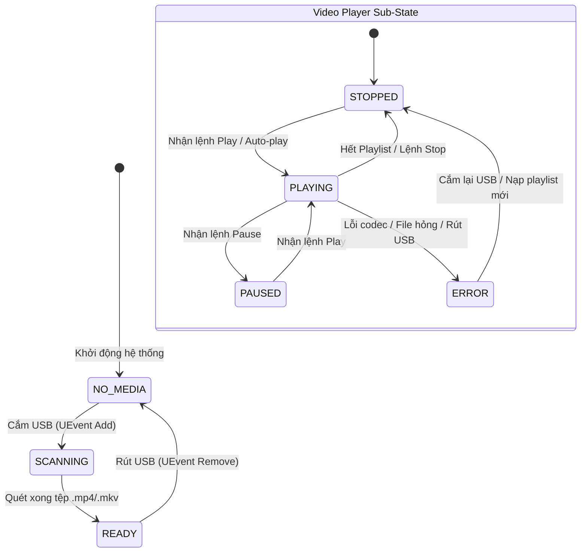

# TÀI LIỆU KIẾN TRÚC HỆ THỐNG (SYSTEM ARCHITECTURE)
## USB Video Player Cho Raspberry Pi 4 (Yocto Linux)

---

## 1. Tổng Quan Kiến Trúc

Hệ thống được thiết kế theo mô hình **3 tiến trình độc lập (Decoupled Micro-services)** giao tiếp với nhau thông qua **D-Bus System Bus**. Kiến trúc này đảm bảo tính chịu lỗi cao: nếu một tiến trình gặp sự cố (ví dụ GUI crash hoặc GStreamer gặp video lỗi), `systemd` sẽ tự động khởi động lại tiến trình đó mà không làm sập toàn bộ hệ điều hành hay ảnh hưởng đến các service khác.



---

## 2. Chi Tiết Từng Tiến Trình (Modules)

### 2.1. `ojt-media-manager` (Dịch vụ quản trị USB & Playlist)
* **Ngôn ngữ:** Thuần C (C99), thư viện `GLib-2.0`, `libudev`.
* **D-Bus Object:** `/org/automotive/MediaManager` trên bus name `org.automotive.MediaManager`.
* **Cơ chế hoạt động:**
  1. Sử dụng `udev_monitor_new_from_netlink` để lắng nghe sự kiện cắm/rút thiết bị trực tiếp từ nhân Linux.
  2. Lọc thiết bị: Chỉ nhận các node phân vùng thỏa mãn `ID_BUS=usb` và `ID_FS_USAGE=filesystem` (ví dụ `/dev/sda1`). Bỏ qua ổ đĩa thô (`/dev/sda`).
  3. Tự động mount phân vùng vào thư mục `/media/usb0` theo chế độ **Read-Only** (bảo vệ toàn vẹn dữ liệu USB).
  4. Quét đệ quy tìm các tệp tin có đuôi mở rộng `.mp4` và `.mkv` (không phân biệt hoa/thường).
  5. Phát tín hiệu D-Bus `PlaylistChanged(count)` thông báo cho toàn hệ thống.
  6. Xử lý cả trường hợp **Coldplug** (USB đã cắm sẵn trước khi máy tính khởi động) bằng `udev_enumerate`.

### 2.2. `video-player` (Bộ phát đa phương tiện)
* **Ngôn ngữ:** C++17, thư viện `GStreamer-1.0`, `gio-2.0`.
* **D-Bus Object:** `/org/automotive/VideoPlayer` trên bus name `org.automotive.VideoPlayer`.
* **Cơ chế hoạt động:**
  1. Đóng vai trò vừa là **D-Bus Client** (lắng nghe `PlaylistChanged` từ MediaManager) vừa là **D-Bus Service** (cung cấp API điều khiển cho GUI).
  2. Tạo pipeline đa phương tiện dựa trên phần tử cấp cao `playbin`.
  3. Khởi tạo bus thread riêng để theo dõi các sự kiện stream (`ERROR`, `EOS`, `STATE_CHANGED`, `ELEMENT`).
  4. Khi nhận được lệnh `SetVideoWindow(xid)`, gán cửa sổ hiển thị thông qua interface `GstVideoOverlay`:
     ```cpp
     gst_video_overlay_set_window_handle(GST_VIDEO_OVERLAY(sink), xid);
     ```
  5. Tự động phát bài kế tiếp khi bài hiện tại chạy hết (*End Of Stream - EOS*).

### 2.3. `ojt-gui` (Giao diện người dùng)
* **Ngôn ngữ:** C++17, framework `Qt5` (QtWidgets, QtDBus).
* **Hiển thị:** Chạy trên X Server cục bộ thông qua `xinit`.
* **Cơ chế hoạt động:**
  1. Phân chia bố cục: Bên trái là widget hiển thị video rỗng (`videoWidget`), bên phải là danh sách bài hát và hàng nút điều khiển (`Play`, `Pause`, `Prev`, `Next`, `+10s`, `-10s`).
  2. Lấy `WId` của `videoWidget` thông qua `winId()` và truyền qua D-Bus cho `video-player`. Nhờ đó, GStreamer vẽ hình ảnh trực tiếp lên bề mặt X11 mà không cần đi qua bộ render của Qt, tiết kiệm tối đa CPU.
  3. Sử dụng `QDBusPendingCall` (bất đồng bộ) với timeout 3 giây: Nếu tiến trình `video-player` bận hoặc tạm treo, giao diện Qt vẫn mượt mà không bị đơ chuột/cảm ứng.

---

## 3. Máy Trạng Thái Hữu Hạn (Finite State Machine)



---

## 4. Cơ Chế Xử Lý Lỗi Race Condition & Bền Bỉ (Robustness Architecture)

Để đảm bảo hệ thống không bị treo hoặc rò rỉ khi người dùng rút cắm USB liên tục khi video đang phát:

### 4.1. Kỹ thuật `Generation Counter` (Khử sự kiện trễ - Stale Events)
* **Vấn đề:** Khi USB bị rút giữa chừng, pipeline nhận lỗi I/O (`EIO`). Nếu thread đọc bus đã lấy message lỗi ra đúng lúc người dùng cắm lại USB mới, lỗi cũ sẽ đánh sập bài hát mới vừa được nạp.
* **Giải pháp:** Backend quản lý biến đếm `generation_` tăng dần sau mỗi lần nạp/dừng pipeline:
  ```cpp
  // Chỉ xử lý event nếu thế hệ message khớp với thế hệ hiện tại của player
  if (generation != backend_->generation() || playlist_.empty()) {
      return; // Bỏ qua sự kiện rác của bài cũ
  }
  ```

### 4.2. Xả triệt để GstBus bằng `GST_STATE_NULL`
Khi dừng hoặc đổi bài, pipeline lập tức chuyển về `GST_STATE_NULL`. Ở trạng thái này, GStreamer tự động:
1. Đóng toàn bộ File Descriptor đang mở trên USB (cho phép `umount` an toàn không dính lỗi `target is busy`).
2. Tự động flush sạch toàn bộ queue message cũ còn tồn đọng trên Bus.

### 4.3. Loại trừ đói Mutex (Lock Starvation Elimination)
Trong vòng lặp `busLoop`, tuyệt đối không giữ mutex khi đang sleep/chờ tin nhắn:
```cpp
// 1. Lấy message không chờ trong Lock
{
    std::lock_guard<std::mutex> lock(genMutex_);
    msg = gst_bus_pop_filtered(bus_, filter);
    generation = generation_;
}
// 2. Chờ ngoài Lock -> Trả lượt CPU cho thread chính xử lý lệnh D-Bus
if (!msg) {
    std::this_thread::sleep_for(std::chrono::milliseconds(20));
    continue;
}
```
