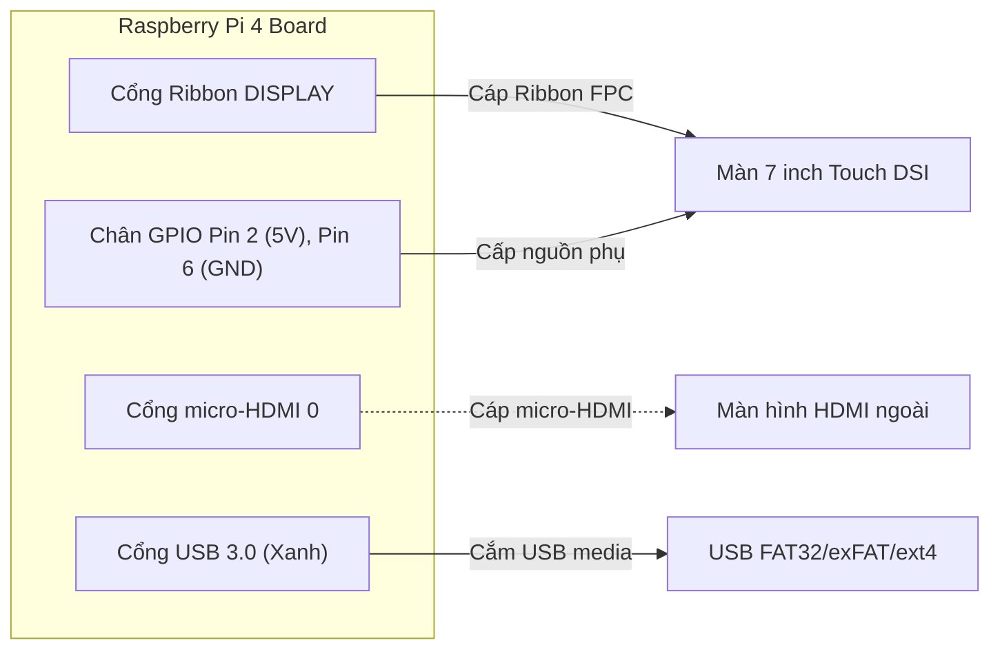

# HƯỚNG DẪN TRIỂN KHAI & CÀI ĐẶT (DEPLOYMENT GUIDE)
## Nạp Thẻ Nhớ, Đấu Nối Phần Cứng & Quản Lý Dịch Vụ Systemd

---

## 1. Nạp Hệ Điều Hành Vào Thẻ Nhớ (Flashing SD Card)

Sau khi quá trình build Yocto hoàn tất, image nằm tại thư mục deploy:
`build/tmp/deploy/images/raspberrypi4-64/`

### 1.1. Sử dụng công cụ `bmaptool` (Khuyến nghị - Nhanh gấp 5 lần `dd`)
Xác định chính xác ổ thẻ nhớ (ví dụ `/dev/sdX` qua lệnh `lsblk`):

```bash
cd build/tmp/deploy/images/raspberrypi4-64/
sudo bmaptool copy --bmap core-image-minimal-raspberrypi4-64.rootfs.wic.bmap \
    core-image-minimal-raspberrypi4-64.rootfs.wic.bz2 /dev/sdX
```

### 1.2. Sử dụng lệnh `dd` truyền thống (Nếu không có bmaptool)
```bash
bzcat core-image-minimal-raspberrypi4-64.rootfs.wic.bz2 | sudo dd of=/dev/sdX bs=4M status=progress conv=fsync
```

---

## 2. Kết Nối Phần Cứng (Hardware Setup)



### 2.1. Cấu hình Màn hình 7" DSI Touchscreen (v1.1, 800×480)
1. Cắm cáp ribbon vào cổng **DISPLAY** trên mạch Pi 4 (không cắm nhầm sang cổng CAMERA cạnh cổng Ethernet).
2. Dây nguồn cấp cho panel: Chân đỏ cắm vào **Pin 2 (5V)**, chân đen cắm vào **Pin 6 (GND)** của hàng chân GPIO.
3. Trong phân vùng boot `/boot/config.txt` phải có dòng:
   ```ini
   dtoverlay=vc4-kms-dsi-7inch
   ```
4. **Lưu ý quan trọng:** Không cắm đồng thời cáp HDMI khi đang sử dụng màn DSI nếu chưa cấu hình dual-head display trong Xorg.

### 2.2. Cấu hình Màn hình HDMI ngoài
1. Cắm cáp vào cổng **micro-HDMI 0** (cổng nằm sát cổng cấp nguồn USB-C).
2. Xóa hoặc comment dòng `dtoverlay=vc4-kms-dsi-7inch` trong file `/boot/config.txt`.

---

## 3. Quản Lý Dịch Vụ Hệ Thống (Systemd Services)

Hệ thống bao gồm 3 service chạy tự động khi boot:

```
┌────────────────────────┐      ┌────────────────────────┐      ┌────────────────────────┐
│  media-manager.service │      │  video-player.service  │      │    ojt-gui.service     │
│  (Type=simple)         │      │  (Type=simple)         │      │  (Type=simple + xinit) │
│  Exec: media-manager.sh│      │  Exec: video-player.sh │      │  Exec: ojt-gui.sh      │
└────────────────────────┘      └────────────────────────┘      └────────────────────────┘
```

### 3.1. Danh sách lệnh vận hành trên Board

| Thao tác | Câu lệnh Shell |
|---|---|
| Kiểm tra trạng thái 3 service | `systemctl status media-manager video-player ojt-gui` |
| Xem log thời gian thực của Video Player | `journalctl -u video-player -f` |
| Xem log khởi chạy X11 và GUI | `journalctl -u ojt-gui -f` |
| Khởi động lại dịch vụ Video Player | `systemctl restart video-player` |
| Khởi động lại toàn bộ stack đồ họa | `systemctl restart ojt-gui` |

### 3.2. Cấu hình khởi chạy đồ họa X11 trong `ojt-gui.service`
Giao diện Qt5 được bao bọc bởi `xinit` để tự khởi chạy một X server tối giản độc lập trên Display `:0`:
```ini
[Service]
Type=simple
User=root
Environment=DISPLAY=:0
ExecStart=/usr/bin/xinit /usr/bin/ojt-gui.sh -- /usr/bin/Xorg :0 -s 0 -dpms -nocursor
Restart=always
RestartSec=2
```

---

## 4. Quy Trình Hot-Deploy Nhanh Qua Mạng SSH (Không Cần Nạp Lại Thẻ)

Trong quá trình debug, nếu sửa code C/C++, có thể deploy trực tiếp qua mạng Ethernet/Wi-Fi:

```bash
# 1. Đặt IP của board
TARGET_IP="192.168.1.150"

# 2. Copy binary vừa build sang thư mục tạm /tmp trên board
scp build/video-player root@${TARGET_IP}:/tmp/video-player

# 3. Dừng service, ghi đè binary vào /usr/bin và khởi động lại
ssh root@${TARGET_IP} << 'EOF'
    systemctl stop video-player
    mv /tmp/video-player /usr/bin/video-player
    chmod +x /usr/bin/video-player
    systemctl start video-player
    systemctl status video-player --no-pager
EOF
```

---

## 5. Xử Lý Sự Cố Triển Khai Phổ Biến

1. **Màn hình DSI đen ngòm hoặc đèn nền sáng nhưng không có chữ:**
   - Kiểm tra log kernel: `dmesg | grep -iE "dsi|panel|tc358762"`.
   - Nguyên nhân thường do thiếu module: Xác nhận `kernel-modules` đã được cài vào rootfs.
2. **GUI hiển thị nhưng khung video màu đen:**
   - Kiểm tra log: `journalctl -u video-player | grep -i "Video sink"`.
   - Nếu `xvimagesink` không nhận diện được Xv extension, chuyển sink sang `glimagesink` hoặc `ximagesink` bằng biến môi trường:
     Thêm `export OJT_VIDEO_SINK=glimagesink` vào `/usr/bin/video-player.sh`.
3. **USB exFAT / NTFS không tự động mount:**
   - Driver phân vùng chưa được load: `modprobe exfat` hoặc `modprobe ntfs3`.
