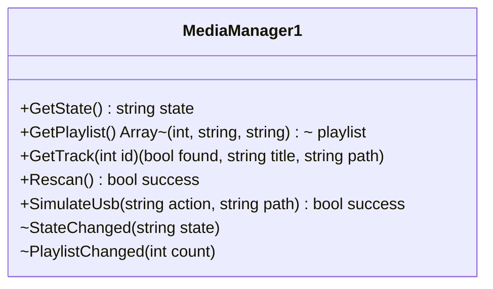
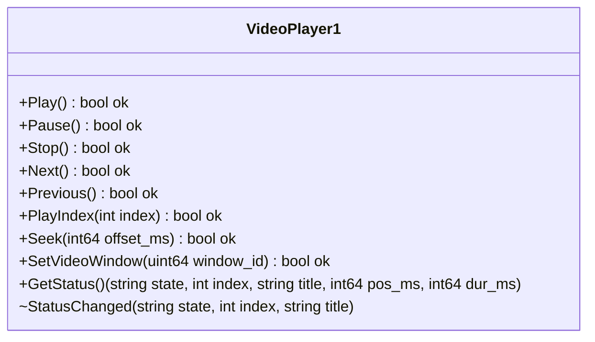
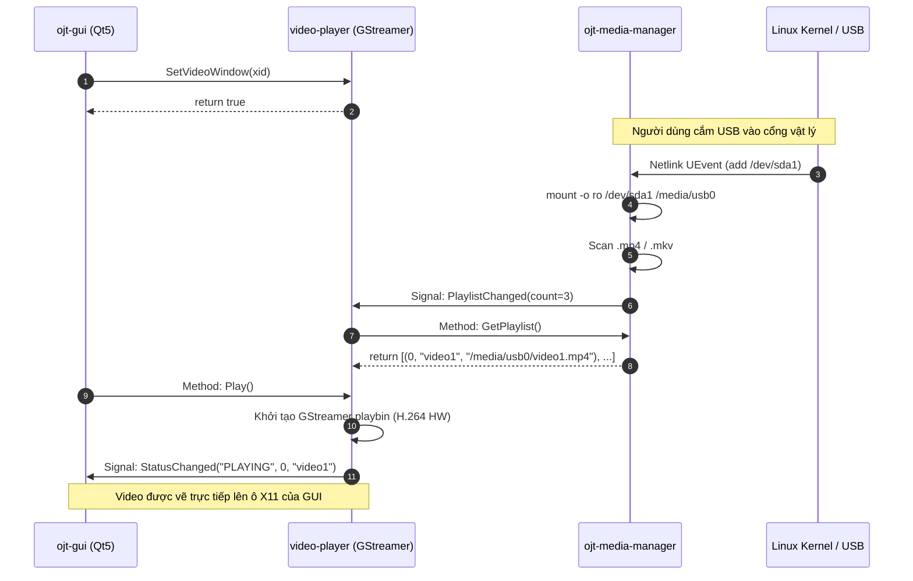

# TÀI LIỆU GIAO THỨC IPC D-BUS (IPC D-BUS PROTOCOL SPECIFICATION)
## Đặc Tả Chi Tiết Giao Tiếp Giữa Các Tiến Trình Đa Phương Tiện

Hệ thống giao tiếp nội bộ thông qua **D-Bus System Bus** tiêu chuẩn (`/var/run/dbus/system_bus_socket`).

---

## 1. Cấu Hình Bảo Mật D-Bus (Security Policy Files)

Để các tiến trình không có quyền root hoặc user thường có thể sở hữu và gọi phương thức, 2 file cấu hình bảo mật được cài đặt vào thư mục `/usr/share/dbus-1/system.d/`:

1. `org.automotive.MediaManager.conf`
2. `org.automotive.VideoPlayer.conf`

```xml
<!DOCTYPE busconfig PUBLIC "-//freedesktop//DTD D-BUS Bus Configuration 1.0//EN"
 "http://www.freedesktop.org/standards/dbus/1.0/busconfig.dtd">
<busconfig>
  <!-- Cho phép root sở hữu tên bus -->
  <policy user="root">
    <allow own="org.automotive.MediaManager"/>
    <allow own="org.automotive.VideoPlayer"/>
  </policy>
  <!-- Cho phép tất cả người dùng gọi phương thức và nhận signal -->
  <policy context="default">
    <allow send_destination="org.automotive.MediaManager"/>
    <allow send_destination="org.automotive.VideoPlayer"/>
    <allow receive_sender="org.automotive.MediaManager"/>
    <allow receive_sender="org.automotive.VideoPlayer"/>
  </policy>
</busconfig>
```

---

## 2. Giao Diện `org.automotive.MediaManager1`

* **Bus Name:** `org.automotive.MediaManager`
* **Object Path:** `/org/automotive/MediaManager`
* **Interface:** `org.automotive.MediaManager1`



### 2.1. Danh Sách Phương Thức (Methods)

#### `GetState() → (s state)`
Truy vấn trạng thái hiện tại của bộ quét USB.
* **Output:**
  * `state` (`string`): Nhận một trong ba giá trị:
    * `"NO_MEDIA"`: Không có USB cắm vào.
    * `"SCANNING"`: Đang mount và đọc cấu trúc thư mục.
    * `"READY"`: Đã quét xong danh sách phát.

#### `GetPlaylist() → (a(iss) playlist)`
Lấy toàn bộ danh sách tệp video đã quét được trên USB.
* **Output:**
  * `playlist` (`Array of Struct (int32, string, string)`):
    * `item[0]`: ID của bài (bắt đầu từ 0).
    * `item[1]`: Tên tiêu đề video (tên tệp lược bỏ phần mở rộng).
    * `item[2]`: Đường dẫn tuyệt đối đến tệp trên filesystem (ví dụ `/media/usb0/video1.mp4`).

#### `GetTrack(i id) → (b found, s title, s path)`
Truy vấn thông tin của một bài cụ thể dựa trên ID.
* **Input:**
  * `id` (`int32`): Chỉ số bài trong danh sách.
* **Output:**
  * `found` (`bool`): `true` nếu tồn tại, `false` nếu nằm ngoài phạm vi.
  * `title` (`string`): Tên tiêu đề bài hát.
  * `path` (`string`): Đường dẫn tệp tin.

#### `Rescan() → (b success)`
Yêu cầu MediaManager quét lại tệp tin trên USB hiện đang cắm.

#### `SimulateUsb(s action, s path) → (b success)`
Dùng cho mục đích kiểm thử tự động không cần cắm USB thật.
* **Input:**
  * `action` (`string`): `"add"` (giả lập cắm) hoặc `"remove"` (giả lập rút).
  * `path` (`string`): Đường dẫn thư mục kiểm thử trên ổ đĩa máy tính host/board.

### 2.2. Danh Sách Tín Hiệu (Signals)

#### `StateChanged(s state)`
Phát ra khi trạng thái chuyển đổi giữa `NO_MEDIA`, `SCANNING` hoặc `READY`.

#### `PlaylistChanged(i count)`
Phát ra ngay sau khi quét xong USB.
* **Tham số:** `count` (`int32`): Tổng số lượng video tìm thấy.

---

## 3. Giao Diện `org.automotive.VideoPlayer1`

* **Bus Name:** `org.automotive.VideoPlayer`
* **Object Path:** `/org/automotive/VideoPlayer`
* **Interface:** `org.automotive.VideoPlayer1`



### 3.1. Danh Sách Phương Thức (Methods)

| Phương thức | Input | Output | Mô tả |
|---|---|---|---|
| `Play` | *Không* | `b ok` | Bắt đầu phát hoặc tiếp tục phát bài hiện tại |
| `Pause` | *Không* | `b ok` | Tạm dừng phát video |
| `Stop` | *Không* | `b ok` | Dừng phát và đưa pipeline về `GST_STATE_NULL` |
| `Next` | *Không* | `b ok` | Chuyển sang bài tiếp theo trong danh sách |
| `Previous` | *Không* | `b ok` | Chuyển về bài trước đó trong danh sách |
| `PlayIndex` | `i index` | `b ok` | Phát bài hát cụ thể theo chỉ mục index |
| `Seek` | `x offset_ms` | `b ok` | Tua tương đối (ví dụ `+10000` = tiến 10s, `-10000` = lùi 10s) |
| `SetVideoWindow` | `t window_id` | `b ok` | Nhúng video vào X11 Window ID cụ thể (`0` = cửa sổ riêng) |
| `GetStatus` | *Không* | `(s, i, s, x, x)` | Lấy `(state, index, title, position_ms, duration_ms)` |

### 3.2. Danh Sách Tín Hiệu (Signals)

#### `StatusChanged(s state, i index, s title)`
Được phát ra mỗi khi trạng thái player thay đổi (bắt đầu phát, tạm dừng, đổi bài, lỗi).
* `state` (`string`): `"PLAYING"`, `"PAUSED"`, `"STOPPED"`, `"ERROR"`.
* `index` (`int32`): Chỉ mục bài hát đang hoạt động.
* `title` (`string`): Tên tiêu đề bài hát.

---

## 4. Trình Tự Tương Tác Giữa Các Tiến Trình (Sequence Diagram)



---

## 5. Lệnh Gọi Thử Nghiệm Qua Terminal (CLI Testing)

```bash
# Kiểm tra trạng thái Media Manager
gdbus call --system --dest org.automotive.MediaManager \
    --object-path /org/automotive/MediaManager \
    --method org.automotive.MediaManager1.GetState

# Ra lệnh Play cho Video Player
gdbus call --system --dest org.automotive.VideoPlayer \
    --object-path /org/automotive/VideoPlayer \
    --method org.automotive.VideoPlayer1.Play

# Tua nhanh 15 giây (+15000 ms)
gdbus call --system --dest org.automotive.VideoPlayer \
    --object-path /org/automotive/VideoPlayer \
    --method org.automotive.VideoPlayer1.Seek 15000

# Theo dõi tín hiệu thời gian thực từ Bus
gdbus monitor --system --dest org.automotive.VideoPlayer
```
