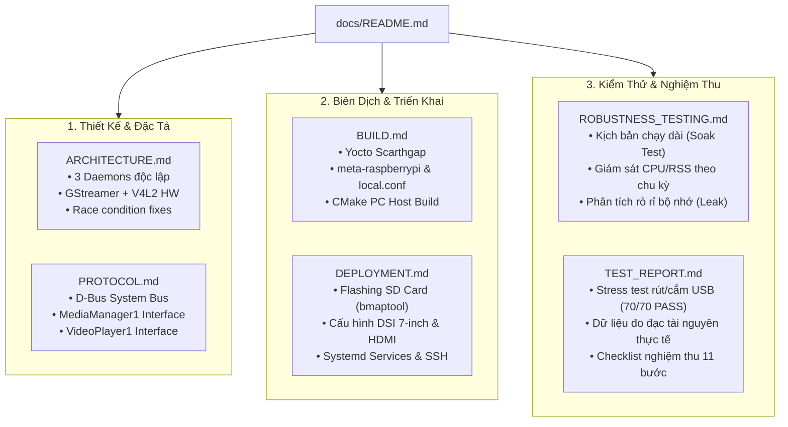

# TÀI LIỆU KỸ THUẬT DỰ ÁN (PROJECT DOCUMENTATION)
## USB Video Player Cho Raspberry Pi 4 (Yocto Scarthgap)

Thư mục `docs/` chứa toàn bộ hồ sơ kỹ thuật, kiến trúc, đặc tả giao thức, hướng dẫn build/deploy và kết quả kiểm thử của dự án:

```
docs/
├── README.md                 # Mục lục và sơ đồ định hướng tài liệu (file này)
├── ARCHITECTURE.md           # Kiến trúc hệ thống 3 tiến trình, FSM, cơ chế chịu lỗi
├── PROTOCOL.md               # Đặc tả giao thức IPC D-Bus (Methods, Signals, Policy)
├── BUILD.md                  # Hướng dẫn build Yocto Linux (RPi4 64-bit) & Local PC
├── DEPLOYMENT.md             # Hướng dẫn nạp thẻ nhớ, đấu nối DSI/HDMI, Systemd, SSH Deploy
├── ROBUSTNESS_TESTING.md     # Kế hoạch test độ bền, chạy dài, đo CPU/RSS, chống Leak/Crash
├── TEST_REPORT.md            # Báo cáo nghiệm thu kiểm thử (Unit, Stress, Soak, Checklist)
└── ojt-usb-video-player.html # Bản tài liệu HTML giao diện web tổng hợp
```

---

## 1. Bản Đồ Tài Liệu Kỹ Thuật



---

## 2. Tóm Tắt Vai Trò Từng Tài Liệu

| Tài liệu | Đối tượng người đọc | Nội dung chính |
|---|---|---|
| [ARCHITECTURE.md](ARCHITECTURE.md) | Software Architect, C/C++ Developer | Phân tích kiến trúc 3 micro-services, vòng đời GStreamer `playbin`, giải mã phần cứng BCM2835, kỹ thuật Generation Counter và khử lock starvation. |
| [PROTOCOL.md](PROTOCOL.md) | System / App Developer | Chi tiết từng hàm, tham số, kiểu dữ liệu D-Bus, tín hiệu phát ra, luồng Sequence Diagram, và file cấu hình phân quyền XML. |
| [BUILD.md](BUILD.md) | BSP / Embedded Linux Engineer | Chi tiết các layer Yocto Scarthgap, cấu hình `local.conf`, tùy chọn font tiếng Việt DejaVu, build image tối giản và cách build nhanh trên máy tính PC. |
| [DEPLOYMENT.md](DEPLOYMENT.md) | Deployment / QA Engineer | Hướng dẫn ghi thẻ nhớ bằng `bmaptool`, đấu nối cáp màn hình DSI 7-inch và HDMI, quy trình hot-deploy binary qua SSH không cần nạp lại thẻ. |
| [ROBUSTNESS_TESTING.md](ROBUSTNESS_TESTING.md) | Test / QA / Software Engineer | Script tự động chạy dài hạn (Soak test), script ghi nhận CPU & RSS chu kỳ 5 giây, các tiêu chí đánh giá Crash-Free và phát hiện rò rỉ RAM (Memory Leak). |
| [TEST_REPORT.md](TEST_REPORT.md) | Project Manager, Technical Lead | Báo cáo chi tiết 70 chu kỳ test rút/cắm USB ngắt quãng giả lập lỗi EIO (100% Pass, 0 crash), bảng thông số tài nguyên thực tế và 11 ca kiểm thử nghiệm thu. |
| [ojt-usb-video-player.html](ojt-usb-video-player.html) | Người dùng, Đào tạo, Trình chiếu | Giao diện Web HTML tích hợp đầy đủ sơ đồ màu, bảng biểu tương tác và mã nguồn giải thích trực quan. |
