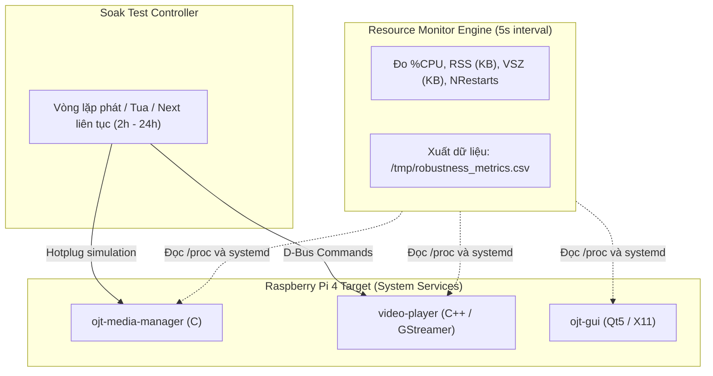

# KẾ HOẠCH & HƯỚNG DẪN KIỂM THỬ ĐỘ BỀN (ROBUSTNESS TEST)
## Chạy Dài (Endurance / Soak Test), Giám Sát CPU/RSS & Đánh Giá Leak/Crash

---

## 1. Mục Đích & Bối Cảnh

Hệ thống Media Player trên Raspberry Pi 4 gồm 3 tiến trình độc lập giao tiếp qua D-Bus (`ojt-media-manager`, `video-player`, `ojt-gui`). Mặc dù hệ thống đã vượt qua stress test rút/cắm USB tức thì (40/40 lần không crash), việc triển khai trên môi trường nhúng đòi hỏi tính ổn định dài hạn (**Robustness / Endurance Testing**):
1. **Chạy dài hạn (Soak / Long-run Test):** Hệ thống phải hoạt động liên tục trong thời gian dài (2h, 4h, 12h, 24h) với các tác vụ đa phương tiện liên tục (phát, chuyển bài, tua, cắm/rút USB).
2. **Giám sát CPU & RSS:** Đo lường mức chiếm dụng CPU (%) và lượng RAM vật lý thực tế (*Resident Set Size - RSS*) của từng process theo chu kỳ thời gian.
3. **Không crash rõ rệt:** 0 lỗi phân đoạn (Segmentation Fault), 0 lần khởi động lại do systemd (`NRestarts = 0`), không dính kernel OOM-killer.
4. **Không rò rỉ bộ nhớ (No Memory Leak):** Sau giai đoạn khởi tạo ban đầu (warm-up), đồ thị RSS phải đi ngang (plateau), không tăng tuyến tính theo thời gian.



---

## 2. Các Tiến Trình Mục Tiêu Cần Giám Sát

| Tiến trình | Ngôn ngữ | Vai trò chính | Nguy cơ tiềm ẩn cần theo dõi |
|---|---|---|---|
| `ojt-media-manager` | C, GLib | Quét ổ USB, quản lý playlist, phát tín hiệu D-Bus | Rò rỉ `GList`, `gchar*`, file descriptor udev |
| `video-player` | C++, GStreamer | Xử lý pipeline `playbin`, giải mã phần cứng H.264 | Rò rỉ GstBuffer, bus message, lock contention |
| `ojt-gui` | C++, Qt5 | Giao diện đồ họa hiển thị playlist, điều khiển | Rò rỉ QPixmap/Widget, D-Bus asynchronous pending call |

---

## 3. Cấu Hình Yocto Bổ Sung Gói Đo Lường

Để thu thập chỉ số chính xác trên board Linux nhúng (minimal rootfs), cần bổ sung các công cụ giám sát tài nguyên vào image:

Mở file: `rasp/custom-source/meta-ojt/recipes-core/images/core-image-minimal.bbappend` và thêm `procps`, `sysstat`:
```bitbake
IMAGE_INSTALL += " \
    file-operation \
    network-config \
    media-manager \
    video-player \
    ojt-gui \
    kernel-modules \
    procps \
    sysstat \
"
```
* `procps`: Cung cấp lệnh `ps`, `top`, `free`.
* `sysstat`: Cung cấp công cụ đo hiệu năng chuyên sâu `pidstat`.

---

## 4. Script Giám Sát Tài Nguyên: `monitor_resources.sh`

Script này chạy nền với chi phí tài nguyên cực thấp (đọc trực tiếp thông tin từ `ps` hoặc `/proc/<pid>/statm`), chu kỳ đo 5 giây/lần và ghi ra định dạng CSV chuẩn:

```bash
#!/bin/sh
# /usr/bin/monitor_resources.sh
# Ghi nhận CPU (%), RSS (KB), VSZ (KB) và số lần Restart của 3 service
OUTPUT_CSV="${1:-/tmp/robustness_metrics.csv}"
INTERVAL=5

echo "timestamp,process,pid,cpu_pct,rss_kb,vsz_kb,restarts" > "$OUTPUT_CSV"

TARGETS="ojt-media-manager video-player ojt-gui"

while true; do
    TS=$(date +"%Y-%m-%d %H:%M:%S")
    for SVC in $TARGETS; do
        PID=$(pgrep -f "$SVC" | head -n 1)
        if [ -n "$PID" ]; then
            STATS=$(ps -p "$PID" -o %cpu,rss,vsz --no-headers 2>/dev/null)
            RESTARTS=$(systemctl show -p NRestarts "$SVC" 2>/dev/null | cut -d= -f2)
            RESTARTS=${RESTARTS:-0}

            if [ -n "$STATS" ]; then
                CPU=$(echo $STATS | awk '{print $1}')
                RSS=$(echo $STATS | awk '{print $2}')
                VSZ=$(echo $STATS | awk '{print $3}')
                echo "$TS,$SVC,$PID,$CPU,$RSS,$VSZ,$RESTARTS" >> "$OUTPUT_CSV"
            fi
        else
            echo "$TS,$SVC,NOT_RUNNING,0,0,0,-1" >> "$OUTPUT_CSV"
        fi
    done
    sleep $INTERVAL
done
```

---

## 5. Script Kịch Bản Chạy Dài: `run_robustness_test.sh`

Script này thực thi chuỗi hành vi người dùng liên tục trong suốt khoảng thời gian định trước (mặc định 2 giờ hoặc tùy biến):

```bash
#!/bin/sh
# /usr/bin/run_robustness_test.sh [số_giờ]
DURATION_HOURS=${1:-2}
DURATION_SECS=$((DURATION_HOURS * 3600))
CSV_LOG="/tmp/robustness_${DURATION_HOURS}h_$(date +%Y%m%d_%H%M%S).csv"

echo "=========================================================="
echo " KHỞI ĐỘNG ROBUSTNESS TEST: ${DURATION_HOURS} GIỜ"
echo " Log file: ${CSV_LOG}"
echo "=========================================================="

# 1. Bật monitor chạy nền
monitor_resources.sh "$CSV_LOG" &
MONITOR_PID=$!

cleanup() {
    echo "Dừng kiểm thử và lưu dữ liệu..."
    kill $MONITOR_PID 2>/dev/null
    exit 0
}
trap cleanup INT TERM EXIT

# 2. Khởi tạo phát video đầu tiên
video-player-test.sh play

START_TIME=$(date +%s)
LOOP_COUNT=0

while true; do
    NOW=$(date +%s)
    ELAPSED=$((NOW - START_TIME))
    if [ $ELAPSED -ge $DURATION_SECS ]; then
        break
    fi

    LOOP_COUNT=$((LOOP_COUNT + 1))
    echo "[$(date +%T)] Vòng lặp #$LOOP_COUNT (Đã chạy: ${ELAPSED}s / ${DURATION_SECS}s)"

    # Phát video bình thường 45s
    sleep 45

    # Tua nhanh 10 giây (Seek stress)
    video-player-test.sh seek 10000
    sleep 15

    # Chuyển bài kế tiếp (EOS / Pipeline reload stress)
    video-player-test.sh next
    sleep 30

    # Tạm dừng và tiếp tục
    video-player-test.sh pause
    sleep 5
    video-player-test.sh play
    sleep 25
done

echo "=========================================================="
echo " HOÀN TẤT KIỂM THỬ ĐỘ BỀN THÀNH CÔNG!"
echo " Kết quả log đã ghi tại: $CSV_LOG"
echo "=========================================================="
```

---

## 6. Tiêu Chuẩn Nghiệm Thu (Pass / Fail Criteria)

Sau khi hoàn tất kịch bản chạy dài (tối thiểu 2h - khuyến nghị 8h/24h), đánh giá kết quả theo các tiêu chí nghiêm ngặt sau:

### 6.1. Tiêu chí Ổn định (Crash-Free)
* **Chỉ số Restart:** Trường `restarts` trong CSV của cả 3 tiến trình phải giữ nguyên bằng **0** trong toàn bộ thời gian.
* **Kernel Segfault:** Lệnh `dmesg | grep -iE "segfault|oom-killer|killed process"` không được có bất kỳ thông báo lỗi nào.
* **D-Bus Health:** Kiểm tra trạng thái cuối cùng của 3 service:
  ```bash
  systemctl is-active ojt-media-manager video-player ojt-gui
  # Cả ba phải trả về: active
  ```

### 6.2. Tiêu chí Rò Rỉ Bộ Nhớ (Memory Leak - RSS Analysis)
* **Giai đoạn Khởi động (Warm-up, 15 - 30 phút đầu):**
  - RSS có thể tăng dần từ 10MB đến 35MB khi GStreamer tải các plugin, nạp driver phần cứng VC4, và Qt5 dựng bộ nhớ đệm font DejaVu.
* **Giai đoạn Ổn định (Plateau Phase, sau 30 phút):**
  - Đường RSS phải đạt trạng thái cân bằng (đi ngang).
  - **Độ dốc tăng trưởng (Slope):**
    $$\Delta RSS = RSS_{\text{kết thúc}} - RSS_{\text{sau warm-up}}$$
    $\Delta RSS$ phải dao động quanh mức $\le 5\%$ tổng mức tiêu thụ. Nếu RSS liên tục tăng tuyến tính dốc đứng theo thời gian, hệ thống bị rò rỉ bộ nhớ (Memory Leak).

```
RSS (MB)
  ▲
40│                ┌────────────────────────────────────── (Plateau: Đạt chuẩn PASS)
  │               /
20│   ┌──────────┘                                       (Dốc tăng dần: FAIL - Leak)
  │  / ◄── Warm-up (15-30p)                              
 0└──┴────────────────────────────────────────────────► Thời gian (giờ)
     0            0.5             2             4
```

### 6.3. Tiêu chí Tải CPU (CPU Utilization)
* Trên Raspberry Pi 4 (Quad Cortex-A72), khi giải mã H.264 qua phần cứng (`v4l2h264dec` / `bcm2835-codec`):
  - `video-player`: CPU trung bình dao động trong khoảng **15% - 35%**. Không được vượt quá 85% hoặc kẹt 100% (spinlock).
  - `ojt-gui`: CPU trung bình **< 10%** (chỉ vẽ giao diện và thanh timeline).
  - `ojt-media-manager`: CPU trung bình **< 2%** (chờ sự kiện I/O netlink).

---

## 7. Phân Tích Báo Cáo Nhanh (Post-Test Analysis)

Sử dụng lệnh `awk` trực tiếp trên board hoặc copy file CSV về host để phân tích cực nhanh:

```bash
# Xem giá trị CPU/RSS lớn nhất và nhỏ nhất của từng tiến trình
awk -F',' 'NR>1 {
    proc=$2; cpu=$4; rss=$5;
    if (cpu > max_cpu[proc]) max_cpu[proc]=cpu;
    if (rss > max_rss[proc]) max_rss[proc]=rss;
    if (min_rss[proc]=="" || rss < min_rss[proc]) min_rss[proc]=rss;
    last_rss[proc]=rss;
    if (first_rss[proc]=="") first_rss[proc]=rss;
}
END {
    printf "%-20s %-12s %-12s %-12s %-12s\n", "Process", "Max CPU(%)", "Min RSS(KB)", "Max RSS(KB)", "Net Delta(KB)";
    for (p in max_cpu) {
        printf "%-20s %-12.1f %-12d %-12d %-12d\n", p, max_cpu[p], min_rss[p], max_rss[p], (last_rss[p] - first_rss[p]);
    }
}' /tmp/robustness_2h.csv
```
